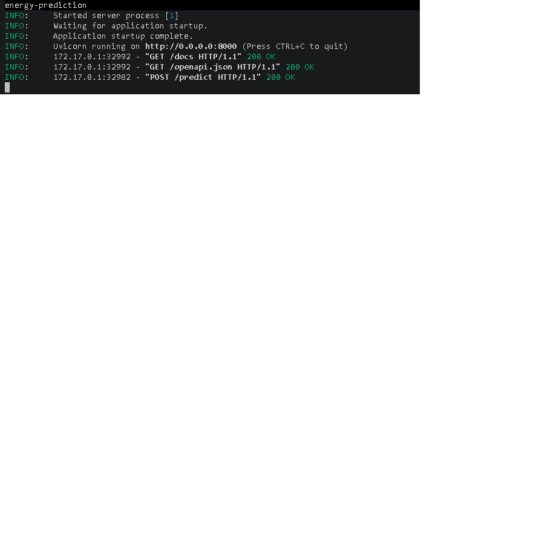
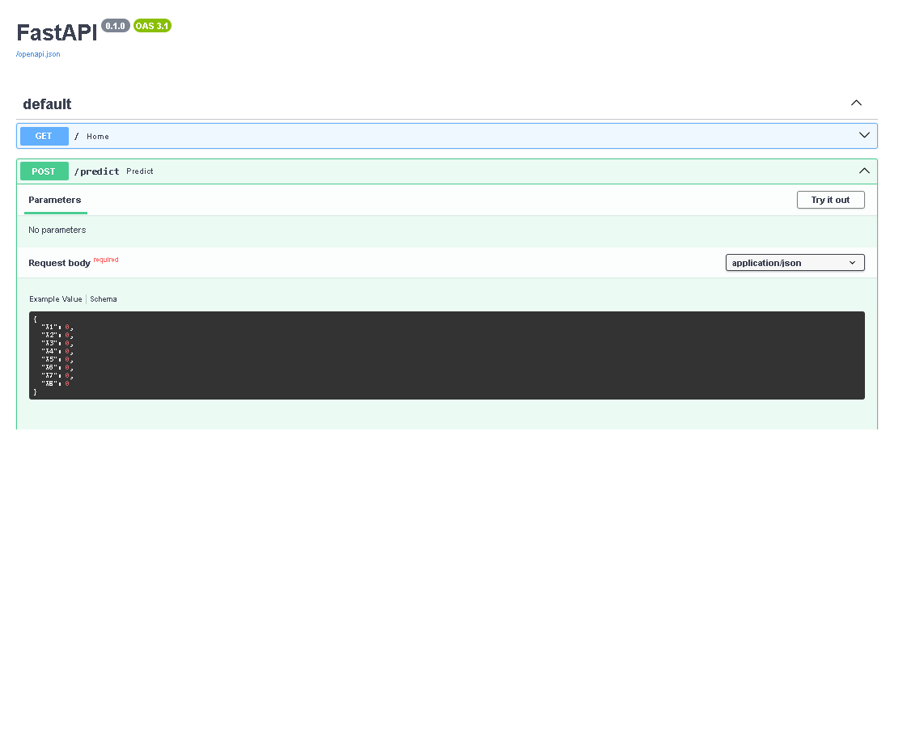
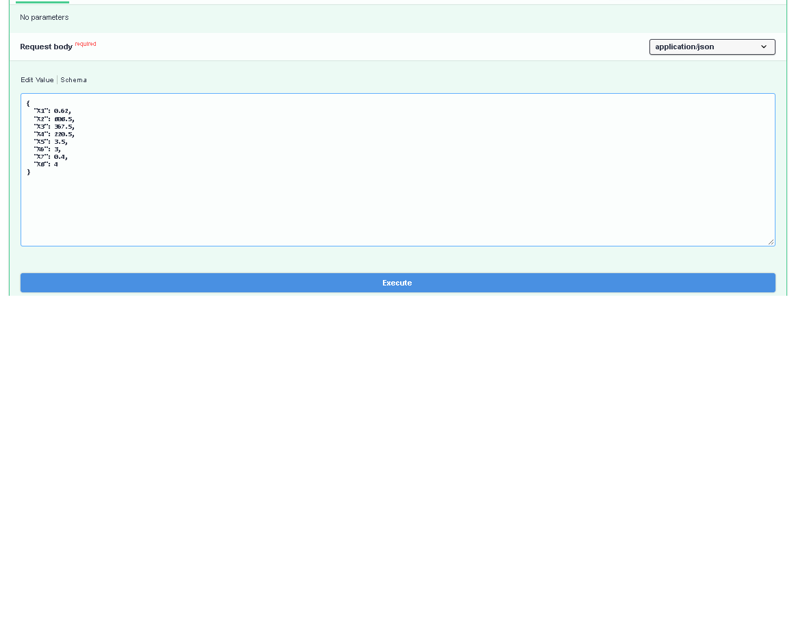
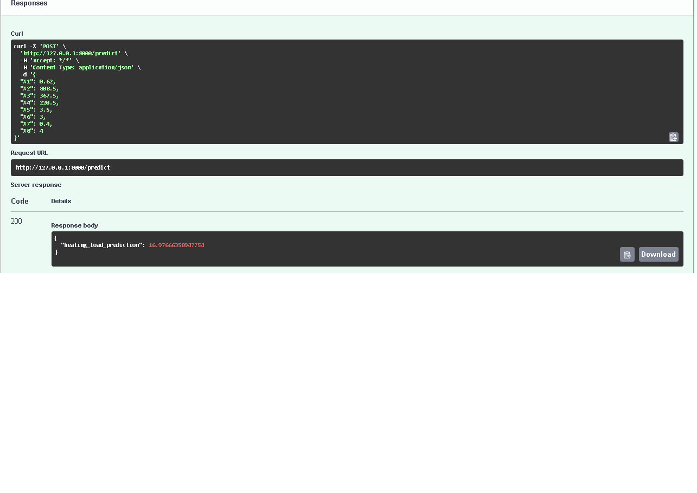

# Energy Efficiency Prediction (Heating Load)

## 📌 Problem Description
Assessing the energy efficiency of buildings during the early architectural design phase is crucial for constructing sustainable and cost-effective structures. This project aims to predict the **Heating Load (Y1)** of residential buildings based on their architectural geometry and physical attributes.

## 📊 Dataset
* **Source:** UCI Machine Learning Repository — [Energy Efficiency Dataset](https://archive.ics.uci.edu/dataset/242/energy+efficiency)
* **Features (X1 to X8):** Relative Compactness, Surface Area, Wall Area, Roof Area, Overall Height, Orientation, Glazing Area, and Glazing Area Distribution.
* **Target (Y1):** Heating Load (kWh/m²)

## 🤖 Model & Evaluation
After performing Exploratory Data Analysis (EDA) and feature engineering, multiple models were evaluated (Linear Regression, Ridge, Random Forest, and XGBoost). 

**XGBoost** was selected as the final model. It successfully captured the non-linear interactions between building dimensions, heavily relying on `X1` (Relative Compactness) as the primary predictor. 

* **Final Validation RMSE:** ~0.38
* **Final Test RMSE:** 0.4114

## 📂 Project Structure
* `Notebook.ipynb` - Exploratory data analysis, feature selection, and model tuning.
* `train.py` - Final script to train the XGBoost model and export it as `model.bin`.
* `predict.py` - FastAPI script to serve the model via a web service.
* `Dockerfile` - Containerization setup for deployment.
* `requirements.txt` - Python dependencies required to run the project.
* `Data/` - Folder containing the raw dataset (`ENB2012_data.xlsx`).

## 🚀 Deployment Proof
The service has been successfully containerized using Docker and deployed locally via FastAPI. 

Below is a visual walkthrough of the running application:

<table>
  <tr>
    <td align="center"><b>1. Docker Container Running</b><br></td>
    <td align="center"><b>2. FastAPI Swagger UI</b><br></td>
  </tr>
  <tr>
    <td align="center"><b>3. Sending JSON Request</b><br></td>
    <td align="center"><b>4. Successful Prediction (200 OK)</b><br></td>
  </tr>
</table>

## 💻 How to Run Locally (Without Docker)

1. **Clone the repository and navigate into the project folder.**
2. **Create and activate a virtual environment:**
   ```bash
   python -m venv venv
   source venv/bin/activate  # On Windows use: .\venv\Scripts\activate
   ```
3. **Install dependencies:**
   ```bash
   pip install -r requirements.txt
   ```
4. **Train the model and generate `model.bin`:**
   ```bash
   python train.py
   ```
5. **Start the FastAPI server:**
   ```bash
   uvicorn predict:app --reload
   ```
6. **Access the API:** Open your browser and go to `http://127.0.0.1:8000/docs` to interact with the Swagger UI.

## 🐳 How to Run with Docker

1. **Build the Docker image:**
   ```bash
   docker build -t energy-prediction .
   ```
2. **Run the container:**
   ```bash
   docker run -it -p 8000:8000 energy-prediction
   ```

## 🧪 How to Test the API

Once the server is running (either locally or via Docker), open your browser and go to `http://127.0.0.1:8000/docs`.

Follow these steps to make a prediction:
1. Expand the **POST /predict** endpoint by clicking on it.
2. Click the **Try it out** button on the right side.
3. Replace the default JSON in the request body with the following sample:
   ```json
   {
     "X1": 0.62,
     "X2": 808.5,
     "X3": 367.5,
     "X4": 220.5,
     "X5": 3.5,
     "X6": 3,
     "X7": 0.4,
     "X8": 4
   }
   ```
4. Click the **Execute** button.
5. Scroll down to the **Server response** section to check the response. You should see a `200` status code and a JSON object containing the `heating_load_prediction`.